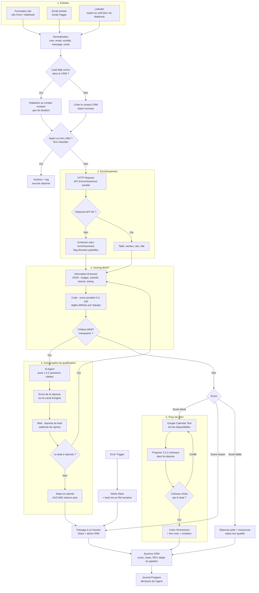

# Agent IA de qualification des leads et prise de RDV (n8n)

## Objectif
Répondre vite à chaque lead entrant, qu'il arrive par le formulaire du site, par email ou par LinkedIn. L'agent enrichit la fiche, calcule un **score de qualification** (BANT : Budget, Autorité, Besoin, Timing), pose les questions manquantes **uniquement quand le lead écrit**, propose un créneau dans le calendrier, synchronise le CRM et passe la main à un humain dès que c'est nécessaire.

> **Règle absolue : aucune relance automatique.** L'agent répond aux messages du lead, il ne le relance jamais. Si le lead ne répond pas, le dossier passe en statut « en attente » et c'est un humain qui décide de la suite.

## Schéma

## Explication étape par étape

1. **Entrées multiples** : le formulaire du site (nœud `n8n Form Trigger` ou `Webhook`), les emails entrants (`Gmail Trigger`) et LinkedIn. LinkedIn n'offre pas de déclencheur natif pour les messages dans n8n : on passe par un export, un formulaire LinkedIn Lead Gen relié par un outil tiers, ou une saisie manuelle qui appelle un `Webhook`.
2. **Normalisation** : un nœud `Edit Fields (Set)` ramène tout au même format (nom, email, société, message, canal d'origine).
3. **Dédoublonnage CRM** : recherche du contact par email. S'il existe, on rattache le nouveau message au contact au lieu d'en créer un second.
4. **Filtre spam / hors cible** : un `Text Classifier` trie spam, candidature, fournisseur et vrai prospect. Le spam est archivé sans réponse.
5. **Enrichissement** : un `HTTP Request` interroge une API d'enrichissement (au choix de l'équipe). Si l'API échoue ou ne trouve rien, le flux continue avec un indicateur « données partielles » au lieu de s'arrêter.
6. **Scoring BANT** : un `Information Extractor` lit le message et la fiche enrichie, et renvoie un JSON (budget évoqué, rôle de la personne, besoin exprimé, échéance). Un nœud `Code` calcule ensuite le score avec **des pondérations définies par l'équipe commerciale** : le calcul est déterministe, l'IA extrait mais ne note pas.
7. **Conversation de qualification** : s'il manque des critères, l'`AI Agent` rédige une réponse avec une ou deux questions ciblées, envoyée sur le canal d'origine. Le flux attend la réponse (`Wait` avec reprise par webhook). **Si le lead ne répond pas, rien n'est renvoyé** : le dossier passe « en attente » et un humain est notifié.
8. **Routage par score** : score élevé → prise de RDV ; score moyen → humain ; score faible → réponse polie avec des ressources utiles, sans pression commerciale. Les seuils sont des paramètres à fixer par l'équipe.
9. **Prise de RDV** : l'agent lit les disponibilités (`Google Calendar Tool`), propose 2 ou 3 créneaux, puis crée l'événement avec le lien visio dès que le lead en choisit un. En cas de conflit (créneau pris entre-temps), il relit le calendrier.
10. **Synchro CRM** : score, résumé de la conversation, RDV et étape du pipeline sont écrits dans le CRM (`HubSpot`, `Pipedrive` ou autre).
11. **Journal** : chaque décision de l'agent (score, route choisie, raisons) est enregistrée dans Postgres pour audit et amélioration des règles.
12. **Gestion d'erreurs** : un workflow `Error Trigger` envoie une alerte Slack et place le lead dans la file humaine, pour qu'aucun lead ne se perde.

## Nœuds n8n principaux
`n8n Form Trigger` / `Webhook` / `Gmail Trigger` → `Edit Fields (Set)` → `HubSpot` ou `Pipedrive` (recherche / création) → `Text Classifier` → `HTTP Request` (enrichissement) → `Information Extractor` → `Code` (score) → `Switch` → `AI Agent` + `OpenAI Chat Model` + `Simple Memory` / `Postgres Chat Memory` + `Google Calendar Tool` → `Wait` → `Gmail` (réponse) → `Google Calendar` → `Slack` → `Postgres` ; `Error Trigger` → `Slack`.

## Garde-fous
- **Jamais de relance automatique** : l'agent ne répond qu'aux messages reçus. Aucune séquence, aucun email de rappel, aucun « je reviens vers vous ». Les rappels de RDV éventuels se règlent dans le calendrier du lead via l'invitation, pas par des messages de l'agent.
- **Validation humaine** : au démarrage, mettre les réponses de l'agent en brouillon à valider avant envoi, puis assouplir quand la qualité est prouvée. Tout lead à score moyen ou sensible (grand compte, réclamation) part à un humain.
- **Transparence** : l'agent se présente comme un assistant automatisé et propose toujours de parler à une personne.
- **RGPD** : informer le lead du traitement de ses données (mention sur le formulaire), limiter l'enrichissement aux données professionnelles, fixer une durée de conservation, honorer les demandes de suppression.
- **Coûts** : modèle léger pour la classification et l'extraction, modèle plus puissant seulement pour la rédaction ; limite de tours de conversation par lead ; suivi de la consommation de tokens.
- **Sécurité** : le texte du lead est traité comme une donnée, jamais comme une instruction (protection contre l'injection de prompt) ; l'agent n'a accès qu'aux outils calendrier et CRM nécessaires, en lecture/écriture limitée.
